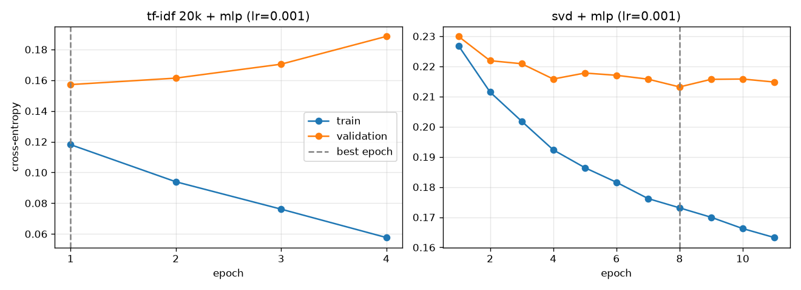
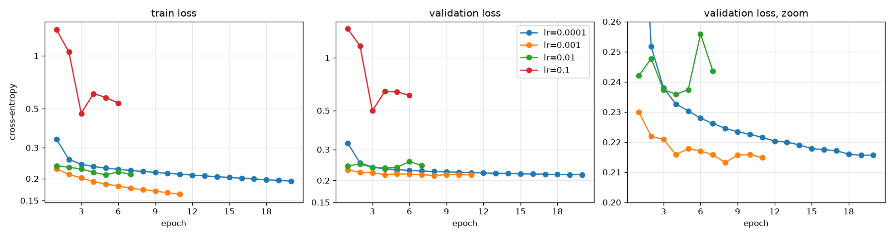

# NLP 2 - Analyse de sentiment avec un MLP

Suite du TP 1 sur les critiques Allociné. On entraîne un petit MLP avec PyTorch et on le compare au meilleur modèle du TP 1 (TF-IDF + régression logistique), avec les mêmes splits et les mêmes métriques.

## Lancer le TP

```bash
uv run main.py
```

- Environ 9.5 min sur CPU.
- Le dataset (`tblard/allocine`) est téléchargé depuis Hugging Face au premier lancement (fichiers parquet gardés en cache).
- Les courbes de loss sont enregistrées dans `results/`.
- Les scores des modèles et quelques erreurs s'affichent dans le terminal.
- Les chiffres ci-dessous viennent d'un seul lancement. Les temps sont des temps réels mesurés sur un CPU 12 cœurs partagé avec d'autres jobs, donc ils sont seulement indicatifs.

## Données

Même préparation qu'au TP 1. On enlève les lignes avec une valeur manquante et on normalise le texte (entités HTML décodées, minuscules, URLs et balises HTML supprimées, espaces multiples réduits à un seul). Les doublons sont repérés sur le texte sans ponctuation ni espaces. On les supprime, ainsi que les textes vides et les textes qui apparaissent avec deux labels. Ensuite on retire les critiques de validation déjà présentes dans train, et les critiques de test déjà présentes dans train ou validation.

| split | critiques | positives |
|---|---|---|
| train | 159297 | 50.4% |
| validation | 19890 | 49.0% |
| test | 19882 | 48.0% |

Les vectoriseurs, la SVD et le scaler sont ajustés sur train uniquement. Le learning rate, l'époque d'arrêt et les seuils de décision sont choisis sur validation, et test n'est utilisé qu'une fois, à la fin.

## Modèles

Tous les modèles utilisent la tokenisation du TP 1 (mots, "!", "?" et smileys comme ":)") avec les unigrammes et bigrammes vus dans au moins deux critiques, et un TF-IDF sublinéaire.

- `tf-idf + logreg` : le modèle du TP 1, réentraîné ici. 859830 features, régression logistique avec C=10 (son meilleur réglage sur validation au TP 1).
- `tf-idf 20k + logreg` : le même classifieur sur les 20000 n-grams les plus fréquents.
- `svd + logreg` : le même classifieur sur ces 20000 features projetées en 256 dimensions par une SVD tronquée (17.3% de la variance gardée), puis standardisées.
- `tf-idf 20k + mlp` et `svd + mlp` : `Linear(n, 128) -> ReLU -> Dropout(0.3) -> Linear(128, 2)` sur les deux mêmes entrées (2560386 et 33154 paramètres), entraînés avec la cross-entropy et Adam sur des mini-batches de 256 critiques. Les lignes sparse sont densifiées un mini-batch à la fois. 20 époques maximum, early stopping après 3 époques sans meilleure loss de validation, puis on restaure les meilleurs poids.

L'étude du learning rate se fait sur l'entrée SVD, qui s'entraîne beaucoup plus vite. Le MLP à 20000 entrées est entraîné une seule fois, avec le learning rate retenu. Comme au TP 1, on règle ensuite le seuil de décision de chaque modèle sur validation (de 0.3 à 0.7, pas de 0.05).

## Courbes d'apprentissage

Cross-entropy de train et de validation après chaque époque, avec le learning rate retenu (0.001). Les deux sont calculées en mode eval (sans dropout) pour pouvoir les comparer.



## Learning rate

`svd + mlp` entraîné avec quatre learning rates et la même seed. Les loss sont prises à la meilleure époque. La macro F1 de validation est calculée avec les poids restaurés et un seuil de 0.5. On choisit le learning rate sur la macro F1 de validation, comme C au TP 1, alors que l'early stopping se base sur la loss de validation.

| lr | époques faites | meilleure époque | loss train | loss val | macro F1 val | temps (s) |
|---|---|---|---|---|---|---|
| 0.0001 | 20 | 19 | 0.1954 | 0.2156 | 0.9130 | 107.9 |
| 0.001 | 11 | 8 | 0.1731 | 0.2132 | **0.9133** | 63.4 |
| 0.01 | 7 | 4 | 0.2172 | 0.2359 | 0.9061 | 25.2 |
| 0.1 | 6 | 3 | 0.4706 | 0.4985 | 0.8485 | 26.3 |

L'étude prend 223 s. Le graphe de droite zoome sur la loss de validation (lr=0.1 sort de l'échelle).



## Comparaison sur test

Jeu de test, 19882 critiques. Le temps d'entraînement inclut le vectoriseur (et la SVD). Pour les MLP, il compte seulement le run avec le learning rate retenu. Le temps de prédiction couvre tout le jeu de test, vectorisation comprise.

| modèle | seuil | accuracy | F1 négatif | F1 positif | macro F1 | entraînement (s) | prédiction (s) |
|---|---|---|---|---|---|---|---|
| tf-idf + logreg | 0.55 | **0.9453** | **0.9476** | **0.9427** | **0.9452** | 54.8 | 3.11 |
| tf-idf 20k + logreg | 0.55 | 0.9397 | 0.9424 | 0.9368 | 0.9396 | 49.5 | 2.96 |
| svd + logreg | 0.55 | 0.9021 | 0.9069 | 0.8967 | 0.9018 | 88.3 | 3.20 |
| tf-idf 20k + mlp | 0.50 | 0.9416 | 0.9437 | 0.9392 | 0.9415 | 185.1 | 4.35 |
| svd + mlp | 0.45 | 0.9115 | 0.9143 | 0.9085 | 0.9114 | 146.4 | 3.24 |

Le modèle du TP 1 réentraîné donne la même matrice de confusion sur test qu'au TP 1 (492 critiques négatives prédites positives, 596 critiques positives prédites négatives).

Avec la même régression logistique, limiter le vocabulaire à 20000 n-grams fait perdre 0.6 point de macro F1 (de 0.9452 à 0.9396), et la SVD 3.8 points de plus (0.9018). La couche cachée ajoute 0.2 point sur les 20000 features (0.9415) et 1.0 sur l'entrée SVD (0.9114). 872 critiques de test sont mal classées à la fois par le meilleur MLP et par le modèle du TP 1, 290 seulement par le MLP, et 216 seulement par la régression logistique.

## Analyse des erreurs

Cinq erreurs de test tirées au hasard pour `tf-idf 20k + mlp`, le MLP qui a la meilleure macro F1 de validation. p est la probabilité de "positif", comparée à 0.5 pour le MLP et à 0.55 pour la régression logistique. `main.py` affiche les textes complets.

| n° test | vrai label | p MLP | p logreg | critique (extrait) |
|---|---|---|---|---|
| 15419 | positif | 0.261 | 0.249 | "j'avais vraiment bien aimé l'idée même si [...] l'histoire est franchement pas terrible [...] c'est très malsain!!" |
| 8885 | positif | 0.048 | 0.083 | "les graphismes sont bien [...] ce film nous laisse sur notre faim [...] j'aurais aimé qu'il y ait une suite !" |
| 13079 | négatif | 0.540 | 0.677 | "Je commencerai par le positif, la réalisation est tout à fait correcte [...] me donne la gerbe." |
| 2004 | négatif | 0.522 | 0.453 | "A voir seulement pour John Travolta et les quelques commentaires parfois drôles du bébé." |
| 8769 | négatif | 0.781 | 0.809 | "Une comédie de moeurs agréable [...] Dommage que la 2ème partie [...] soit nettement moins drole [...] Indémodable." |

- 15419 et 8885 sont des critiques positives écrites avec des mots négatifs : ici "malsain" est un compliment, et "dommage" parle de l'envie d'avoir une suite. Les deux modèles se trompent, et sur 8885 avec une forte confiance.
- 13079 est une longue critique négative qui commence par les points positifs, et 2004 met tout son verdict dans un seul mot ("seulement"). Le MLP est proche de son seuil sur les deux. La régression logistique, elle, classe bien 2004.
- 8769 est surtout positive et finit sur "Indémodable.", donc son label négatif ne correspond pas au texte.

Les cinq erreurs tirées au hasard pour la régression logistique sont du même genre : des critiques positives avec des mots qui ont l'air négatifs (15480, "une période historique sombre" ; 2013, avec des compliments mal écrits, "bocoup de plaisir", à côté de "minable"), une analyse admirative avec une note basse (8790), et deux critiques qui mélangent compliments et reproches (13228, p=0.548 juste sous le seuil ; 8718). Le MLP classe bien les deux dernières.

## Questions

*Pourquoi réduire les vecteurs du TP 1 avant d'entraîner le réseau ?*

Une couche `Linear` dense sur les 859830 features du TP 1 aurait 110 millions de poids pour 128 unités cachées. C'est trop lent à entraîner sur CPU, et c'est beaucoup plus que ce que 159297 critiques peuvent contraindre. Les 20000 n-grams les plus fréquents gardent presque tout le signal et donnent quand même 2.6 millions de paramètres. Les 256 composantes de la SVD rendent l'entraînement rapide, mais on y perd plus que ce que la couche cachée fait regagner.

*Que montrent les courbes de train et de validation ?*

De l'overfitting, à deux vitesses. Avec 20000 entrées, la loss de validation est au plus bas après la première époque et monte de 0.1572 à 0.1885 à l'époque 4, pendant que la loss de train descend de 0.1181 à 0.0577. Sur l'entrée SVD, la loss de train baisse à chaque époque (de 0.2269 à 0.1633) alors que la loss de validation reste entre 0.2132 et 0.2178 à partir de l'époque 4. L'early stopping garde les époques 1 et 8.

*Quel est l'effet du learning rate ?*

0.0001 est régulier mais lent : il faut 19 époques pour arriver à 0.2156 sur validation, puis on touche la limite des 20 époques. 0.01 est bruité (loss de validation entre 0.2359 et 0.2558), et 0.1 est trop grand : sa loss de train vaut 1.4073 après une époque, ce qui est pire que le 0.693 d'une prédiction constante p=0.5. 0.001 donne la loss de validation la plus basse et la meilleure macro F1 de validation. Par contre, à ce learning rate, le réseau à 20000 entrées overfitte dès la première époque et ferait peut-être mieux avec un learning rate plus petit (pas testé).

*Quel modèle garder ?*

TF-IDF + régression logistique. Il a la meilleure macro F1 sur test (0.9452 contre 0.9415 pour le meilleur MLP) et la meilleure F1 sur les deux classes. Il s'entraîne 3.4 fois plus vite (54.8 s contre 185.1 s, plus 223 s d'étude du learning rate pour le MLP) et prédit plus vite (3.11 s contre 4.35 s). En plus, il n'a qu'un seul hyperparamètre (C), et ses poids se lisent comme un score par n-gram. Sur une entrée TF-IDF sparse, la couche cachée apporte peu par rapport à un modèle linéaire.
