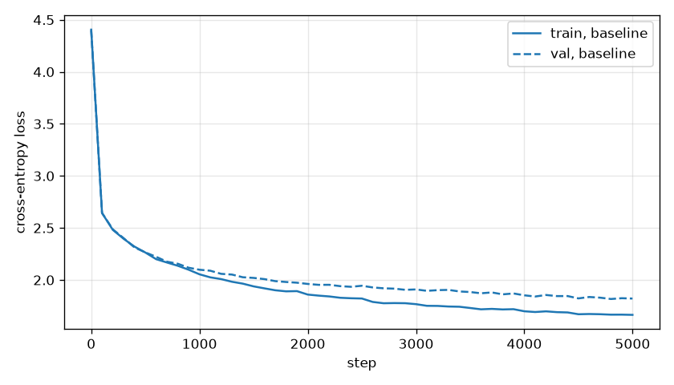
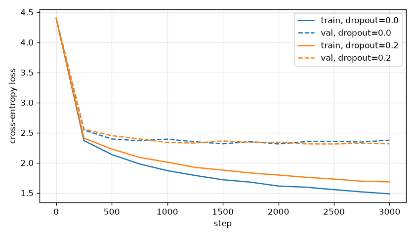

# Transformers 4 - GPT from scratch

Un petit GPT (Transformer decoder-only) au niveau caractère, entraîné sur Tiny Shakespeare en suivant "Let's build GPT" de Karpathy. On réunit les briques des TP Transformers 1 à 3 (`04-bigram-language-model`, `05-self-attention`, `06-layernorm-feedforward`), on entraîne le modèle puis on génère du texte.

## Lancer le TP

```bash
uv run main.py          # environ 4 min sur CPU
uv run experiments.py   # environ 8 min sur CPU
```

- `main.py` entraîne le modèle et génère du texte, `experiments.py` compare la taille du contexte, le nombre de têtes et le dropout.
- Les deux scripts partagent `data.py` (corpus, vocabulaire, batches), `model.py` (les modules du Transformer) et `training.py` (évaluation, boucle d'entraînement, courbe de loss).
- Les deux scripts limitent PyTorch à un seul thread CPU : avec `n_embd = 64`, les produits de matrices sont trop petits pour gagner quelque chose avec plus de threads.
- Le corpus est téléchargé dans `data/input.txt` au premier lancement.
- Les courbes, le texte généré et le tableau des expériences sont enregistrés dans `results/`.

## Modèle

Configuration du TP : `batch_size = 16`, `block_size = 32`, `n_embd = 64`, `n_head = 4`, `n_layer = 4`, `dropout = 0.0`, AdamW avec `lr = 1e-3`, 5000 steps, losses moyennées sur 200 batches par split tous les 100 steps, seed 1337. Le vocabulaire fait 65 caractères et le split donne 1,003,854 caractères d'entraînement et 111,540 de validation.

Formes pour un batch d'entraînement (B = 16, T = 32, C = 64, V = 65, taille de tête 16) :

| module | formes | paramètres |
|---|---|---|
| `token_embedding_table` | idx (B, T) -> (B, T, C), table (65, 64) | 4,160 |
| `position_embedding_table` | arange(T) -> (T, C), table (32, 64) | 2,048 |
| `Head` | (B, T, C) -> q, k, v (B, T, 16), wei (B, T, T) -> (B, T, 16) | 3,072 |
| `MultiHeadAttention` | 4 x (B, T, 16) -> concat (B, T, C) -> proj (B, T, C) | 16,448 |
| `FeedForward` | (B, T, C) -> (B, T, 4C) -> (B, T, C) | 33,088 |
| `Block` | x + sa(ln1(x)), puis x + ffwd(ln2(x)), (B, T, C) | 49,792 |
| `blocks` (4 blocs) | (B, T, C) -> (B, T, C) | 199,168 |
| `ln_f` | (B, T, C) -> (B, T, C) | 128 |
| `lm_head` | (B, T, C) -> logits (B, T, V) | 4,225 |
| total | | 209,729 |

`main.py` affiche `parameters: 209729 (0.210M)`.

## Résultats

### Entraînement

L'entraînement a pris 209 s.

| step | loss train | loss val |
|---|---|---|
| 0 | 4.4051 | 4.4002 |
| 500 | 2.2637 | 2.2649 |
| 1000 | 2.0545 | 2.0984 |
| 2000 | 1.8597 | 1.9618 |
| 3000 | 1.7676 | 1.9091 |
| 4000 | 1.6993 | 1.8526 |
| 4999 | 1.6648 | 1.8215 |



La loss initiale (4.40) est proche de ln 65 = 4.17, la loss d'une prédiction uniforme sur le vocabulaire. Train et val restent à moins de 0.05 l'une de l'autre jusqu'au step 1000, puis l'écart monte à 0.16 à la fin. La loss de validation baisse encore (valeur minimale 1.8172 au step 4800), donc le modèle ne fait pas encore d'overfitting avec cette configuration.

### Textes générés

Avant l'entraînement (300 caractères), le modèle sort des caractères au hasard :

```
DuJAMJ3fX$VWoGCYngj$'onoE,$AT-NvynticCzJ-c!bnDNyjwND,?to;
VcANzq:nU$3NVAz:YzgNkceei.-efVhpXz,NApQe.3hRfNThglUzoecXgZ q.g?d
xeo$ug:'QmZqRzF!neLZmh.TW,$NJko.iu!seNwol$zJipJhwiKeo,Ssnu3blKpSpbMcSWhWmYn&UwNUc-qmfjkeRecJDeqqNWVa-?gLrR X&M ?BJxRlB;?zUC
blOHdJV
XXo;Vch.kt?Hpza:hoV.NarnDozmp zPj-!gTsoSN-FgA
```

Après l'entraînement, début des 2000 caractères générés (texte complet dans `results/sample.txt`) :

```
shide spost I vour:
And weret, and to go the rieghter's for which wratichblent
And true and from to broth.

Romon:
What's wit.

TRANCE:
Nowby all:
I swo giver and anour,
As cousins consmilly with have mine,
And fly mayly you hum.
Thire to-dimely untelled to be thre I shat not
Is apot arth,
On precain, him speech'd that him;
Or by the did your hound. By have them braje this I rave?

WARWICK:
God want of soverit the hape of ascartenes forth adies it.

EDWARD:
Sto! my troarl not it off that crount.
```

On retrouve la mise en page d'une pièce de théâtre : les noms des personnages en majuscules suivis de deux-points, des vers courts, des lignes vides entre les répliques, et quelques vrais noms de personnages (WARWICK, EDWARD). Les mots fréquents sont bien écrits (and, the, with, your, et même cousins), beaucoup de mots plus longs sont inventés (wratichblent, consmilly, soverit), et les phrases n'ont pas de sens. Le modèle ne voit que les 32 derniers caractères, moins qu'un vers, donc rien ne tient au-delà de quelques mots.

### Expériences

Même seed et même optimiseur, évaluation tous les 250 steps. La ligne baseline est la configuration du TP entraînée 2000 steps au lieu de 5000. Les temps sont juste indicatifs, car la machine était partagée avec d'autres jobs.

Sur le train set complet, le modèle ne fait pas d'overfitting en 2000 steps. Les runs avec dropout utilisent donc seulement les 50,000 premiers caractères d'entraînement pendant 3000 steps (3000 x 512 = 1,536,000 tokens, environ 30 passages sur ce sous-ensemble), avec le même set de validation. Réduire les données coûte moins cher qu'agrandir le modèle, ce qui rendrait chaque step plus lent.

Les tableaux sont copiés depuis `results/experiments.md`.

#### Taille du contexte et nombre de têtes, 2000 steps

| run | params | loss train | loss val | meilleure loss val | temps (s) |
|---|---|---|---|---|---|
| block_size=16 | 208,705 | 1.9122 | 2.0148 | 2.0148 (step 1999) | 40 |
| baseline | 209,729 | 1.8729 | 1.9679 | 1.9679 (step 1999) | 59 |
| block_size=64 | 211,777 | 1.8158 | 1.9359 | 1.9359 (step 1999) | 112 |
| n_head=1 | 209,729 | 1.8467 | 1.9623 | 1.9623 (step 1999) | 51 |

#### Dropout, 50,000 premiers caractères d'entraînement, 3000 steps

| run | params | loss train | loss val | meilleure loss val | temps (s) |
|---|---|---|---|---|---|
| dropout=0.0 | 209,729 | 1.4836 | 2.3745 | 2.3124 (step 2000) | 87 |
| dropout=0.2 | 209,729 | 1.6812 | 2.3140 | 2.3116 (step 2500) | 106 |



Un contexte plus long fait baisser la loss val, mais la comparaison ne porte pas que sur le contexte : un batch de 16 séquences contient 256, 512 ou 1024 cibles, donc les runs avec un contexte plus long voient aussi plus de données par step. Le temps augmente avec T pour la même raison, en plus de la matrice d'attention T x T.

Une tête de taille 64 et quatre têtes de taille 16 ont le même nombre de paramètres (W_Q, W_K, W_V font 3 x 64 x 64 au total dans les deux cas). Leurs losses val diffèrent de 0.006, c'est moins que le bruit d'une évaluation à l'autre dans `main.py` (environ 0.01), donc plusieurs têtes n'apportent pas de gain mesurable à cette échelle.

Sans dropout, le modèle apprend le sous-ensemble par cœur : à partir du step 750, la loss train continue de baisser (1.9794 à 1.4836) alors que la loss val reste entre 2.31 et 2.39, donc l'écart passe de 0.39 à 0.89. Le dropout 0.2 ralentit la baisse de la loss train (1.6812 à la fin) et réduit l'écart final à 0.63, mais la meilleure loss val est la même (2.3116 contre 2.3124) : le dropout retarde la mémorisation mais n'apporte aucune information. La configuration du TP sur le corpus complet n'en a pas besoin, puisque sa loss val baisse encore à la fin des 5000 steps.

## Questions

*Étape 0. Calculer d_h = n_embd / n_head. Combien de tokens contient un batch ? Sur CPU, quelle variable réduire en premier pour tester ?*

d_h = 64 / 4 = 16. Un batch contient batch_size x block_size = 16 x 32 = 512 tokens, donc 512 prédictions du caractère suivant par step. Pour un test rapide, je réduirais d'abord `max_iters` (avec `eval_iters`), car ça raccourcit le run sans changer le modèle. L'évaluation coûte cher ici : 51 évaluations x 2 splits x 200 batches = 20,400 forward passes, contre 5000 steps d'entraînement.

*Étape 1. Pourquoi utiliser k.size(-1) plutôt que C pour le facteur d'échelle ?*

Le produit scalaire q·k fait la somme sur la taille de tête (16), pas sur C (64). Si q et k ont une variance de 1, les scores ont une variance égale à la taille de tête, et diviser par sa racine carrée la ramène à 1. Diviser par sqrt(C) rendrait les scores 2 fois plus petits que prévu (sqrt(64) / sqrt(16) = 2), donc le softmax serait plus plat. Les deux ne coïncident qu'avec une seule tête.

*Étape 1. Pourquoi tronquer tril[:T, :T] ?*

Le masque est créé une seule fois à la taille maximale (block_size, block_size), mais l'entrée peut être plus courte : pendant la génération, T commence à 1 et augmente jusqu'à block_size. En découpant, on obtient un masque (T, T) qui correspond à `wei`.

*Étape 2. Pourquoi concaténer sur la dernière dimension ?*

Chaque tête renvoie (B, T, 16) pour les mêmes séquences et les mêmes positions, seules les features changent. Concaténer sur `dim=-1` met côte à côte les quatre sorties de chaque token et redonne (B, T, 64), que `proj` peut mélanger et qu'on peut ajouter au flux résiduel. Concaténer sur la dim 1 créerait 4T positions à la place.

*Étape 2. Quel problème aurait-on si n_embd n'était pas divisible par n_head ?*

`head_size = n_embd // n_head` est arrondi vers le bas, donc la concaténation aurait moins de n_embd features (3 x 21 = 63 pour n_embd = 64 et n_head = 3). `proj`, un `Linear(n_embd, n_embd)`, planterait alors avec une erreur de dimensions. C'est pour ça que `Block` vérifie `n_embd % n_head == 0` avec un assert.

*Étape 3. Dans quel ordre appliquer la LayerNorm, l'attention/le MLP et l'addition ? À quelles opérations correspondent la "communication" et le "calcul" ?*

Pre-norm : on normalise l'entrée de la branche, on applique la sous-couche, puis on ajoute le résultat à l'entrée non normalisée, `x = x + sa(ln1(x))` puis `x = x + ffwd(ln2(x))`. Le chemin résiduel lui-même n'est jamais normalisé, donc le gradient arrive directement jusqu'aux premières couches. La communication, c'est la self-attention, le seul endroit où une position lit les autres positions (via `wei`). Le calcul, c'est le réseau feed-forward, appliqué à chaque token séparément.

*Étape 4. Donner les dimensions des trois matrices d'embedding/unembedding. Pourquoi lm_head n'est plus la même chose que l'embedding ?*

Embedding des tokens (65, 64), embedding des positions (32, 64), et `lm_head` passe de 64 à 65 (poids stocké en (65, 64) plus un biais de 65). Dans le modèle bigramme du TP Transformers 1, la table faisait (65, 65) et la ligne du caractère courant donnait directement les logits du suivant. Maintenant l'embedding produit un vecteur de dimension 64, les blocs le transforment en une représentation de tout le contexte, et il faut une matrice à part pour passer de cet espace aux 65 logits du vocabulaire. Lire un token et prédire le suivant sont deux tâches différentes (GPT-2 partage les deux matrices, ce modèle les garde séparées).

*Étape 5. Quelle règle de broadcasting permet d'additionner les deux embeddings ? Pourquoi ne pas aplatir les logits pendant la génération ?*

Les dimensions sont alignées en partant de la droite : dans (B, T, C) + (T, C), `pos_emb` est traité comme (1, T, C) et répété sur le batch, donc chaque séquence reçoit les mêmes vecteurs de position. L'aplatissement en (B*T, V) existe seulement parce que `F.cross_entropy` attend des logits (N, V) et des cibles (N,). Pendant la génération il n'y a pas de cibles, et `generate` a besoin de `logits[:, -1, :]`, la dernière position de chaque séquence, ce qui demande le format (B, T, V).

*Étape 6. Pourquoi @torch.no_grad() ? Pourquoi échantillonner avec multinomial plutôt que toujours prendre l'argmax ?*

La génération n'appelle jamais `backward()`. Sans `no_grad`, chaque forward garderait ses activations et construirait un graphe pour un backward qui n'arrive jamais, ce qui coûte juste de la mémoire et du temps. Avec l'argmax, le modèle écrit toujours la même suite pour un contexte donné et tombe facilement dans des boucles sur les motifs les plus fréquents. Échantillonner à partir du softmax suit la distribution apprise, y compris les caractères moins probables mais valides, ce qui donne un texte varié.

*Étapes 7-8. Pourquoi appeler model.eval() puis model.train() ?*

`eval()` passe en mode inférence les couches qui se comportent différemment pendant l'entraînement (ici `Dropout`), donc la loss est mesurée sur le modèle déterministe. `train()` les remet en mode entraînement avant la mise à jour suivante. Avec `dropout = 0.0` ça ne change rien dans `main.py`, mais ça compte pour le run avec dropout 0.2. La LayerNorm se comporte pareil dans les deux modes.

*Étapes 7-8. Si la loss train baisse mais que la loss de validation monte, que se passe-t-il ?*

C'est de l'overfitting : le modèle apprend le texte d'entraînement par cœur au lieu d'apprendre des motifs qui généralisent. L'expérience sur le dropout le montre : sur 50,000 caractères sans dropout, la loss train continue de baisser après le step 750 alors que la loss val stagne, et la dernière loss val (2.3745) est la plus haute depuis le step 1000. Pour corriger, on peut s'arrêter à la meilleure loss de validation, ajouter du dropout, plus de données ou prendre un modèle plus petit.

*Résumé des quatre TP. Relier chaque classe à une notion du cours. Quelle brique crée le contexte ? Laquelle transforme un token ? Laquelle produit les logits ? Où la loss agit-elle sur tout le modèle ?*

| code | notion du cours |
|---|---|
| `get_batch` | prédiction du token suivant : la cible est l'entrée décalée d'un caractère (TP Transformers 1) |
| `token_embedding_table`, `position_embedding_table` | embeddings W_E : identité du caractère et sa place dans le contexte |
| `Head` | self-attention causale : W_Q, W_K, W_V, produit scalaire mis à l'échelle, masque, softmax (TP Transformers 2) |
| `MultiHeadAttention` | plusieurs têtes en parallèle et la projection de sortie W_O |
| `FeedForward` | MLP W_up, ReLU, W_down appliqué à chaque token (TP Transformers 3) |
| `Block` | bloc Transformer : LayerNorm et connexions résiduelles (TP Transformers 3), communication puis calcul |
| `ln_f` | LayerNorm finale, appliquée après le dernier bloc et avant l'unembedding |
| `lm_head` | unembedding W_U vers les 65 logits du vocabulaire |
| `GPTLanguageModel` | modèle decoder-only complet : les embeddings, les n_layer blocs, la norm finale et l'unembedding donnent P(caractère suivant sachant le contexte) |
| `generate` | échantillonnage autorégressif à partir du softmax, avec le contexte coupé à `block_size` |
| `F.cross_entropy`, `train` | loss -log P(cible), backpropagation, descente de gradient avec AdamW |

Le contexte est créé par l'attention (`Head` et `MultiHeadAttention`), la seule opération qui mélange les positions. Un token seul est transformé par `FeedForward` (avec les LayerNorms). Les logits viennent de `lm_head`. La loss est calculée une seule fois à la fin de `forward`, en moyenne sur les B x T prédictions. `loss.backward()` renvoie son gradient à travers `lm_head`, tous les blocs et les deux tables d'embedding, puis `optimizer.step()` met à jour toutes ces matrices en même temps.
